<picture>
  <source media="(prefers-color-scheme: dark)" srcset=".github/readme/banner-dark.svg">
  
</picture>

[](https://github.com/FutureMan0/MagicMirror-4/actions/workflows/ci.yml)

**A smart mirror you set up entirely from your phone.** Turn modules on, move tiles,
switch themes and store credentials in a web app that installs to your home screen.
No config file to edit over SSH.

**Not a MagicMirror² fork.** MM⁴ is its own Electron app with its own module system.
`Module.register`, `node_helper` and regions like `top_bar` don't exist here, and
modules from the MM² ecosystem don't run.

## Quick start

Raspberry Pi 4 or 5, Raspberry Pi OS (64-bit, Bookworm), a screen on HDMI:

```bash
git clone https://github.com/FutureMan0/MagicMirror-4.git
cd MagicMirror-4
chmod +x rpi-install.sh
sudo ./rpi-install.sh
```

Then open `http://<pi-ip>:3000` on your phone, tap **Start pairing on the mirror**
and scan the QR code the mirror shows for 60 seconds.

---

## Contents

- [What the installer does](#what-the-installer-does)
- [Signing in](#signing-in)
- [The app on your phone](#the-app-on-your-phone)
- [Modules](#modules)
- [Themes](#themes)
- [Privacy](#privacy)
- [Connecting Spotify](#connecting-spotify)
- [Updating](#updating)
- [Troubleshooting](#troubleshooting)
- [Development and checks](#development-and-checks)
- [Where things stand](#where-things-stand)

---

## What the installer does

`rpi-install.sh` from the [quick start](#quick-start):

1. **Sets up Node.js 22** if an older version is installed.
2. **Installs the dependencies** — without development tools. That is about
   three quarters fewer packages; on a weak Wi-Fi connection it decides
   whether the installation gets through at all.
3. **Checks that Electron is really there.** The download of the binary can
   break off without the installation reporting an error — the installer then
   fetches it again instead of reporting success for an installation that
   will never become a mirror.
4. **Sets up a kiosk session:** X11 via systemd, mouse pointer off, standby
   off, GPU acceleration on.
5. **Autostart** via pm2, so the mirror comes up by itself after a reboot.

There are **no native dependencies** — no compiling, no
`electron-rebuild`, no ABI questions.

---

## Signing in

The configuration server is not open. On first start MM⁴ generates an admin
token and stores it as `MM_ADMIN_TOKEN` in the `.env` file.

**Pairing your phone:**

1. Open `http://<pi-ip>:3000` in the browser.
2. Tap **“Start pairing on the mirror”**.
3. The mirror shows a QR code for 60 seconds. Scan it — or type in the
   eight-character code below it.

The code only ever appears on the mirror and never goes over the network.
Whoever can read it is in the room: that is exactly the proof. A paired
device stays signed in for 30 days.

**Locked out?** The token from the `.env` works too — in the sign-in dialog
under “Sign in with the token instead”.

**What works without signing in:** requests from the machine itself
(`127.0.0.1`). The modules on the mirror fetch their data over HTTP from
their own address, and anyone with access to the Pi has a shell anyway.
Forwarded requests do **not** count as local: what is checked is the address
of the connection, not an `X-Forwarded-For` header.

**Credentials don't leave the Pi.** For every secret declared in a manifest,
`GET /api/config` returns only `"__SET__"` — set or not set, the browser
learns nothing more.

> `MM_AUTH=off` in the `.env` turns signing in off. Then anyone on the
> network can change the configuration and trigger updates — meant only as an
> emergency exit.

---

## The app on your phone

The web interface is an installable PWA.

1. Open `http://<pi-ip>:3000` and pair.
2. Save something — afterwards the app asks whether it should go on your home
   screen. On iOS you get the instructions via *Share* instead.
3. From then on MM⁴ starts full screen, without the browser bar.

**Live Preview** in the **Layout** tab shows the mirror as it looks on the
wall right now — the same display, live, not a thumbnail.

Without a connection the interface still loads, shows the last known state
and **locks the Save buttons** while doing so. Anyone who kept clicking
offline would otherwise overwrite a state they have never seen.

> **About offline mode:** browsers only allow service workers over HTTPS or
> on `localhost`. On your home network by IP the offline shell is therefore
> inactive — installing and everything else still works.

---

## Modules

A module is a folder under `modules/`. MM⁴ finds it by itself at startup; it
is turned on in the web interface.

| Module | Shows | Needs |
| :--- | :--- | :--- |
| **Clock** | Time and date | — |
| **Weather** | Current conditions and forecast, with matching effects | OpenWeatherMap key (free) |
| **WebUntis** | Timetable as a week or day view | School, server, credentials |
| **Spotify** | Current track with cover, controllable from your phone | Spotify Premium, see below |
| **GitHub** | Latest commits, open pull requests, stars | Repositories as `owner/name`; from two repositories on a token — without one GitHub allows only 60 requests per hour |
| **Gitea** | The same for Gitea or Forgejo, plus the contribution heatmap | Address of the instance and a token; self-signed certificates are allowed if turned on |
| **Unraid** | Array, disk temperatures, parity, Docker containers | Unraid 7, *Settings → Management Access → Developer Options* turned on, key via `unraid-api apikey --create` |
| **Home Assistant** | States of selected entities, switchable from your phone | Address and a long-lived access token (at the very bottom of your HA profile) |

The modules that talk to an outside API are built on the same foundation:
on-disk cache, growing back-off on errors, one fetch for all displays. After a
restart something is therefore on screen immediately instead of nothing for
minutes. During an outage the last known state stays visible — clearly
marked as *“Unreachable — showing data from 12 min ago”*.

Each of these modules has a **connection test** that says more than
“works/doesn't work”: Unraid names the available sections (the GraphQL schema
differs between versions), Home Assistant names entities it cannot find — a
typo in an ID is the most common reason nothing is shown.

**Error messages are sentences, not output.** What the mirror shows reads
“No connection” or “Credentials rejected”. The technical message goes to the
console, where it belongs.

### Switching with Home Assistant

On the mirror the tiles are **read-only** — it is not a touchscreen, and an
accidental touch while walking past would be more annoying than useful.
Switching happens on your phone, in the **Control** tab.

For that, *“Allow switching”* has to be turned on explicitly. Even then three
barriers apply, and all of them have to pass:

1. The entity has to be in your list.
2. Its kind has to be switchable — light, switch, scene, script, media,
   cover, fan, climate.
3. The service has to be known.

**Door locks, alarm systems and `homeassistant.stop` cannot be switched**,
not even if you list them. This list lives in the code, not in the
configuration.

### Your own module

```
modules/my-module/
  module.json    manifest: name, settings, secrets
  index.js       runs on the mirror
  styles.css     optional
  backend.js     optional, runs in the main process
```

`modules/example-hidden/` is the complete template, `modules/github/` the
example of a module with an outside API — about 120 lines of display and 100
lines of backend, half of them comments. The details are in
[`CLAUDE.md`](CLAUDE.md) (in German).

Visible texts in `module.json` — `displayName`, `description`, the labels of
the settings — can be a plain string or `{ "en": "…", "de": "…" }`; the web
interface shows the language that is set.

---

## Themes

Six themes are included, switchable under **Settings → Mirror Theme**:

| Theme | | |
| :--- | :--- | :--- |
| **Minimal** | dark | Typography only. No surfaces, no borders, no continuous animations — which makes it the most frugal variant. |
| **OLED Black** | dark | Pure black and dimmed brightness. On OLED panels the background stays unlit and does not burn in. |
| **Newspaper** | **light** | Serif typesetting with hairlines instead of boxes. Looks like a printed front page. |
| **Nature** | dark | Warm earth tones, soft gradients, serif headings. |
| **Glass** | dark | Frosted-glass surfaces and soft shadows. |
| **Cyberpunk** | dark | HUD look with clipped corners, cyan and yellow, Rajdhani in capitals. |

### Your own theme

A theme reassigns design tokens — it does not need to know the modules:

```
themes/my-theme/
  theme.css     @layer theme { :root { --mm-color-accent: ...; } }
  theme.json    { "name": "My Theme", "mode": "dark", "description": "..." }
```

The folder is enough; the choice in the web interface is read from
`themes/`. All tokens are in `src/renderer/styles/tokens.css`. `name` and
`description` can be `{ "en": "…", "de": "…" }` as well.

Three things that make the difference:

* **No `!important` needed.** Module CSS lives in `@layer module`, themes in
  `@layer theme` — layer order beats specificity and source order. The first
  version of the Cyberpunk theme still needed 21 `!important` for this.
* **`npm run check:tokens`** fails as soon as a module stylesheet contains a
  raw colour or sets text below the readability limit. Whatever doesn't go
  through a token cannot be recoloured by a theme — and in the default theme
  nobody notices.
* **Decoration has to reserve room for itself.** Clipped corners and slants
  sit on top of the content; without a reserve they cut off text.

On weak hardware MM⁴ automatically sets `data-perf="low"` and with that turns
off blur, shadows and continuous animations for **every** theme.

---

## Privacy

Four states, switchable on your phone in the **Privacy** tab:

| | |
| :--- | :--- |
| **Normal** | Everything visible |
| **Guests** | Only clock and weather. Ends by itself after 30 minutes |
| **Shower** | Only a large clock, sensors off |
| **Off** | Display completely dark |

What gets hidden is declared in each module's manifest. **Without a
declaration a module counts as sensitive** — new modules are private until
you release them. A forgotten field would otherwise be a data leak.

Hiding happens through CSS, not by rebuilding: instantly, without flicker,
and the modules keep their state. Modules that offer it also stop their
fetching — a hidden timetable that is still fetched every 15 minutes would
only be half private.

Shower mode is switched by hand, on your phone or by gesture.

> **About sensors, honestly:** a software off is a convenience, not a
> guarantee. On a Raspberry Pi you cannot even cut power to a single USB
> port — all downstream ports are tied together. If there is a camera in the
> room, a **physical switch in the cable** (about €8) is the only convincing
> way to turn it off. The display on your phone shows the *measured* state and
> reports “active” when in doubt.

---

## Connecting Spotify

Works entirely from your phone, in four steps in the module dialog:

1. **Create a Spotify app** in the Spotify dashboard (any name).
2. **Add the redirect URI** — the dialog shows it, ready to copy. It has to
   match exactly, so copy it instead of typing it.
3. **Paste the Client ID.** No Client Secret is needed.
4. **Connect.**

> Spotify requires a **Premium account** for your own apps. Without one the
> process ends in a 403 whose cause is not stated anywhere.

**Why a redirect address somewhere else?** Since 27 Nov 2025 Spotify only
allows `https://` or literal loopback addresses as a redirect URI — which
rules out the Pi's LAN address. The redirect therefore goes through a static
HTTPS page that does nothing but forward: it reads your mirror's address from
the `state` and sends you back there. The credentials themselves never pass
through it.

If the automatic return doesn't work — Chrome's HTTPS-First Mode can get in
the way — the page shows a code to paste.

---

## Updating

In the web interface under **Settings → Update**. Behind it:

```
git pull --ff-only  →  npm ci --omit=dev  →  check Electron  →  restart
```

Three deliberate decisions:

* **`--ff-only`, no `stash`.** Local changes used to be stashed away silently;
  whoever didn't know never found them again. Now the update stops and says
  what is going on.
* **`npm ci`, not `npm install`.** `npm install` rewrites the lockfile at
  every opportunity — that is exactly how it once got broken.
* **Electron is proven to be there before restarting.** `npm ci` reports
  success even when the download of the binary broke off. Without this check
  the mirror would be dead after the restart — with an update that reported
  itself as successful.

If you changed something locally and want to keep it:

```bash
cd MagicMirror-4
git status                       # shows what this is about
git stash push -m "my changes"
git pull --ff-only
git stash pop
```

---

## Troubleshooting

**The screen stays black, the log says `Missing X server or $DISPLAY`.**
Electron was started without a running X server — typical when pm2 is faster
at boot than the graphical session. The bundled installer sets up a kiosk
session via systemd for this and starts MM⁴ inside it. If you used
`pm2 startup` before: the installer disables the `pm2-<user>` service so it
stops starting Electron headless.

**Logs:**

```bash
journalctl -u mm-kiosk -f    # the graphical session
pm2 logs                     # the application
```

**Modules stay empty.** First use the connection test in the module dialog —
it names the cause more precisely than the display on the mirror. The most
common reason is a typo in an ID or an expired token.

**A module is missing entirely.** Is it in `config/instances/<name>.json`?
That file **replaces** the module list from `config/config.json`, it does not
add to it. A module that is only in the general configuration does not
appear on this instance.

**The phone can't reach the mirror.** Are both on the same network? And is
the server running: `curl -s -o /dev/null -w '%{http_code}\n' http://<pi-ip>:3000/`
should return `200`.

**Everything stutters.** Check `vcgencmd measure_temp` and
`vcgencmd get_throttled` — a throttled Pi is the most common cause. Otherwise
a more frugal theme helps (Minimal or OLED Black).

---

## Development and checks

You don't need a Pi to develop; Node 22 is enough.

```bash
npm ci
npm run dev            # Electron with developer tools
```

The web interface is then at `http://localhost:3000`, the mirror itself at
`http://localhost:3000/mirror/` — it also runs in a normal browser.

```bash
npm run verify         # lint, token and readability check, tests
npm run smoke          # really starts the app (needs a screen)
npm run routes         # shows all registered module routes
```

`npm run smoke` starts Electron with a configuration in which **every**
existing module is active, checks that all of them load, and then connects as
a real WebSocket client. In CI this runs across four themes and on Node 20
and 22.

---

## Where things stand

To be honest, so nobody comes with the wrong expectations:

**Checked and working:** the mirror starts on a Raspberry Pi 4 under
Electron 43, all modules load, the live channel transmits changes
immediately, 274 tests pass — on the development machine, in CI and on the Pi
itself. Credentials demonstrably don't leave the device: checked with real
keys on real hardware.

**Known bugs:** the weather module still fetches its data itself instead of
through a backend. On the mirror it works; in the live view on your phone it
stays empty, because the key is deliberately not delivered there. A backend
for it is still to come.

**Not finished yet:** gesture control so far only has a provider without
hardware; a real sensor is not connected. The Visual Editor is a preview — if
the layout misbehaves, switch back to the **classic grid** in the settings.
Shower mode does not turn itself on.

**Not tried:** the web interface on a real phone. It is built and tested as a
PWA, but nobody has installed it yet.

Tested on Raspberry Pi OS Bookworm (64-bit) on a Pi 4. Other combinations
should work but have not been tried.

---

## License

MIT.
